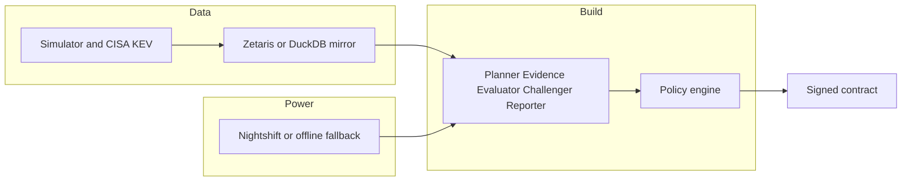

# Arbiter

[](https://github.com/awkwardapples/Arbiter/actions/workflows/ci.yml)


Auditable reasoning for third-party vendor onboarding: agents gather cited evidence, a versioned policy decides, and the next action is a signed contract.

Demo video: not published yet. It is recorded in the submission pass. Until then, the sample runs below are the ones in `output_examples/` and `logs/examples/`.

**Sample mode, no credentials**

```bash
docker build -t arbiter .
docker run --rm -p 8000:8000 -e SAMPLE_MODE=true arbiter
curl -s -X POST localhost:8000/run -H "Content-Type: application/json" -d @input_examples/example_1.json
```

The container listens on port 8000. `SAMPLE_MODE=true` uses the DuckDB mirror. No `.env` file is required.

## Problem and users

A third-party risk analyst decides whether a new SaaS vendor may be onboarded. The evidence is split across procurement, contracts, ITSM, a sanctions watchlist, a vendor questionnaire, and the public vulnerability catalogue. Onboarding is the control point: it is the moment those sources can be checked before access is granted.

Verizon's 2026 Data Breach Investigations Report records third-party involvement in 48% of breaches, up from 30% the year before. Many of the cloud incidents in that section come down to missing or weak MFA and over-broad privileges. Sources: [Verizon, 2026 DBIR (PDF)](https://www.verizon.com/business/resources/Te26/reports/2026-dbir-data-breach-investigations-report.pdf) and [Verizon's summary](https://www.verizon.com/about/news/breach-industry-wide-dbir-finds).

## What Arbiter does

An onboarding request goes in. One of five outcomes comes out: `APPROVE`, `APPROVE_WITH_CONDITIONS`, `REQUEST_INFO`, `ESCALATE`, or `DECLINE`. Facts are cited. Counterfactuals say what evidence would change the answer. The next action is drafted under a signed execution contract.

All enterprise data in this repository is synthetic. The CISA Known Exploited Vulnerabilities catalogue is real public data (CC0).

## Agents

The policy decides. The other roles read, plan, check, challenge, or write. "Can block or retry?" is what that role is allowed to do to the run.

| Name in traces | Kind | Model route | Can | Cannot | Can block or retry? |
|---|---|---|---|---|---|
| `Orchestrator` | Code | — | Route states, enforce loop bounds, safe-escalate on error | Decide an outcome | Retries only inside the bounds below |
| `PlannerAgent` | LLM + fallback | deep | Choose registry queries and revise the plan | Write SQL, or skip a required control | Revises when the Evaluator or Challenger sends work back |
| `EvidenceAgent` | Tools + LLM + fallback | fast | Run registry queries, run ScoutGuard, extract quoted claims | Mark a claim verified | No |
| `EvaluatorAgent` | Code + LLM critic | fast | Ground quotes, detect contradictions, send the plan back | Decide an outcome | Sends the Planner back (at most two loops) |
| `PolicyEngine` | Code | — | Tier the vendor and produce the outcome and counterfactuals | Call an LLM | No |
| `MemoryKeeper` | Meterless H-MEM | fast (mining only) | Retrieve precedents and record feedback | Change the policy | No |
| `ChallengerAgent` | LLM + deterministic triggers | deep | Attack the decision, request one re-plan, escalate | Approve or upgrade an outcome | One re-plan, or an escalation |
| `ReporterAgent` | LLM + validator + fallback | deep | Write a cited dossier and draft actions | Cite anything outside the decision record | No |
| `ScoutGuard` | Meterless Scout subset | fast (ambiguous band only) | Block, warn, or pass untrusted text; redact PII | Decide | Can block a segment |
| `ActionExecutor` | Code (Scout contracts) | — | Issue and verify signed contracts; run the outbox once approvals exist | Act without a valid contract | Holds an action until required approvals are present |

## What makes this an agent system

Two loops are real, and both are bounded:

- Evaluator → Planner, at most two times (`app/orchestrator.py`).
- Challenger → Planner, at most one re-plan. The Challenger can escalate. It cannot approve.

The policy engine is the only component that maps facts to an outcome. The Evaluator re-queries systems of record through the registry. Memory can move a later case toward approval only when the policy's precedent exception says so, and only with the required human role. Actions wait on a signed contract.

This excerpt is from the offline sample run `run-3d6b7460d393` (Quillfeather Payroll Cloud Ltd, `ESCALATE`). The Evaluator sent the Planner back because the vulnerability check had not been run. The full line is in `logs/examples/trace-run-3d6b7460d393.jsonl`:

```jsonl
{"timestamp":"2026-10-23T01:03:17.508010Z","run_id":"run-3d6b7460d393","trace_id":"run-3d6b7460d393","span_id":"95e884fa1ad74355","parent_span_id":null,"agent_name":"EvaluatorAgent","action":"evaluate","input_summary":"claims=16 queries=8","output_summary":"gaps: C06→Q_VENDOR_INCIDENTS; C07→Q_VENDOR_CONTRACT; C08→Q_VENDOR_CONTRACT; C09→Q_VENDOR_CONTRACT; C10→Q_VENDOR_CONTRACT; C12→Q_COMPONENT_KEV","target_agent":"PlannerAgent","confidence":null,"retry_count":0,"status":"needs_revision","provider":null,"route":null,"model":null,"latency_ms":null,"tokens_in":null,"tokens_out":null,"purpose":null,"provider_meta":null,"source_system":null,"query_id":null,"rows":null,"backend":null,"loop":null,"iteration":1,"mode":{"data":"duckdb","llm":"offline"}}
```

The same run's second pass executes `Q_COMPONENT_KEV` on the DuckDB mirror (`backend=duckdb`). Live mode sends that same registry query to Zetaris. See `docs/SPONSORS.md`.

## Architecture



Detail, including the state machine, is in [docs/ARCHITECTURE.md](docs/ARCHITECTURE.md).

## Tech stack

| Piece | What it is |
|---|---|
| Python 3.12 | Language |
| FastAPI 0.159.1, Uvicorn 0.54.0 | HTTP API |
| Pydantic 2.14.1 | Contracts between modules |
| DuckDB 2.0.0 | Sample-mode mirror of the Zetaris model |
| Zetaris | Live federated SQL. Not imported as a library; called over REST |
| Meterless Nightshift | Primary model provider, OpenAI-compatible |
| NVIDIA Nemotron | Models behind Nightshift, or the direct fallback |
| Meterless H-MEM | Governed precedent memory, Python port |
| Meterless Scout | Guard and execution-contract behaviour, implemented here from the spec |
| Streamlit 1.66.1 | Reviewer console |
| httpx 0.28.1, tenacity 9.2.1 | HTTP and retries |
| PyYAML 6.0.3 | Policy and query registry |
| Cursor | Development environment |

There is no agent framework. The orchestrator is an explicit state machine.

## Setup

### Docker, sample mode, no credentials

```bash
docker build -t arbiter .
docker run --rm -p 8000:8000 -e SAMPLE_MODE=true arbiter
```

Wait until the process is serving, then:

```bash
curl -s localhost:8000/health
```

### Native Python

```bash
python -m venv .venv
python scripts/tasks.py setup
```

Activate the virtualenv the usual way for your shell, then:

```bash
SAMPLE_MODE=true LLM_PROVIDER=offline python run.py serve
```

`python scripts/tasks.py setup` installs the pinned requirements into the active interpreter.

### Live mode

Live mode needs Zetaris and Meterless Nightshift on the host. The API process has to run natively. Nightshift listens on the host loopback (`127.0.0.1`), which a container cannot reach. Copy `.env.example` to `.env` and fill in the keys locally. Do not commit `.env`.

Review the onboarding statements before anything is created:

```bash
python run.py zetaris onboard --dry-run
```

Run the real onboard only after that review. Then:

```bash
python run.py preflight
python run.py serve
```

`python run.py preflight` prints provider and data status. It does not print secrets.

## Usage

Start the API with `python run.py serve` or the Docker command above. These three calls use the committed input examples. The outcomes below are abridged from `output_examples/` (offline sample runs, 23 Oct 2026).

```bash
curl -s -X POST localhost:8000/run -H "Content-Type: application/json" -d @input_examples/example_1.json
```

`example_1` (Pellucid Forms Ltd, `run-a1ad72bed1f3`): `APPROVE`, tier T3, residual risk 15. Summary: `ALL_REQUIRED_CONTROLS_MET`.

```bash
curl -s -X POST localhost:8000/run -H "Content-Type: application/json" -d @input_examples/example_2.json
```

`example_2` (Quillfeather Payroll Cloud Ltd, `run-3d6b7460d393`): `ESCALATE`, tier T1. Failing controls include C09 (the vendor claims EU residency; the contract system says US) and C12 (known-exploited vulnerability exposure).

```bash
curl -s -X POST localhost:8000/run -H "Content-Type: application/json" -d @input_examples/example_3.json
```

`example_3` (Oakhaven Mail Relay Ltd, `run-ac35d0a215a4`): `ESCALATE` because untrusted content was blocked (`UNTRUSTED_CONTENT_TAMPERING`).

A judge can POST their own vendor, with no `vendor_id`. Exactly one of `vendor_id` or `submission` is required:

```bash
curl -s -X POST localhost:8000/run -H "Content-Type: application/json" -d '{"submission":{"legal_name":"Example Payroll Ltd","category":"software","requested_service":"payroll processing","criticality":"low","annual_spend_gbp":1000,"data_categories":["internal"],"processing_countries":["UK"],"answers":[{"question_id":"Q01","question":"Is MFA enforced?","answer_text":"Yes."}]}}'
```

Other commands:

```bash
python run.py assess --input input_examples/example_1.json
python run.py examples
python run.py replay CASE-0003
python run.py ui
python run.py audit-verify
python run.py llm status
```

`python run.py assess` calls the same orchestrator entry as `POST /run` and prints that response. `CASE-0003` is the case id on the example 1 run above. `python run.py ui` is the reviewer console (Streamlit). It talks only to the API (`ARBITER_API_URL`, default `http://localhost:8000`).

Human review and contract approval:

- `POST /cases/{case_id}/review` with `reviewer`, `role`, `decision`, and a `rationale` of at least 30 characters. `?dry_run=true` checks precedent eligibility and does not write.
- `POST /contracts/{contract_id}/approve` with `by`, `role`, `decision` (`approve` or `reject`), and a `rationale` of at least 30 characters.
- `GET /cases` returns the queue. `POST /cases/{case_id}/replay` replays a stored decision.

Roles in the shipped policy are `tprm_analyst` and `tprm_lead` (`policy/arbiter_policy.v1.yaml`). Declines require the lead.

## Sample mode

`SAMPLE_MODE=true` runs the same agents, the same registry query ids, and the same policy against a DuckDB mirror of the Zetaris tables. It does not call Zetaris. With `LLM_PROVIDER=offline`, or when Nightshift and NVIDIA are unreachable under `LLM_PROVIDER=auto`, model steps use the deterministic fallback. Those trace events set `provider` to `offline`. The fallback is real logic, labelled as offline. It is not a stored answer.

The six files in `output_examples/` were produced by `python run.py examples` with memory off and `LLM_PROVIDER=offline`. Each header records `mode`, `provider`, `git_sha`, `n_runs`, and `p50_ms`. Regenerating with `--live` is optional and is not what these files are.

## Failure handling

| Failure | What the code does | Trace status |
|---|---|---|
| Zetaris timeout or upstream error | Retry up to three attempts, waiting 1s then 3s (`app/data/zetaris.py`). Then the DuckDB mirror answers that query | `retrying`, then `fallback` |
| Zetaris 401 or 403 | No retry. DuckDB is pinned for the rest of the run | `fallback` |
| Meterless offline | Resolution goes Nightshift, then NVIDIA direct, then the offline generator | `fallback` |
| Model returns invalid JSON | One repair call, then the deterministic fallback for that step | `retrying`, then `fallback` |
| Provider timeout | Meterless calls use 180s. NVIDIA direct uses 90s. The step then uses the deterministic fallback | `fallback` |
| Quote not in the source | The claim is ungrounded. If a required control is affected, the Evaluator sends the plan back | `needs_revision` |
| Injection detected | ScoutGuard blocks the segment and the decision escalates | `blocked`, then `escalated` |
| Contradiction | The Evaluator escalates unless a further system-of-record query resolves it | `needs_revision`, then `escalated` |
| Loop bound reached | The run continues to the decision with the gaps still open, which becomes `REQUEST_INFO` when evidence is missing | `partial_success` |
| Budget exceeded or an unhandled error | Safe escalation with the template report | `error`, then `escalated` |
| Invalid API body | HTTP 400 and the structured error. No stack trace | — |

## Evaluation

Numbers in this section are rendered from `eval/results/20261022T080517661769Z/summary.json`. They are offline. They are not a live Nightshift run. The full write-up is [docs/EVALUATION.md](docs/EVALUATION.md).

<!-- EVAL:START -->
# Evaluation

Synthetic data. Small n. Intervals are Wilson 95% where a rate has a denominator.
Only the tier gates are calibrated. Weights stay at their a-priori values.

- mode: offline (duckdb / offline)
- provider: offline
- model ids (from traces): none recorded
- splits: test
- n: 15
- git sha: a7228be2efe2bca9f004f981db12c1e8dd53704f
- generated: 2026-10-22T08:05:23Z

These numbers are offline. They are not a live Nightshift run.

| System | Accuracy | Unsafe approvals | Invalid | Abstention |
|---|---:|---:|---:|---:|
| arbiter_offline | 1.000 (15/15) | 0/15 | — | 0.000 (0/15) |
<!-- EVAL:END -->

## Sponsor technology

Zetaris is the SQL access point for the five synthetic enterprise systems and the public KEV feed. Meterless Nightshift is the model runtime, H-MEM holds governed precedents, and the Scout subset screens untrusted text and signs actions. NVIDIA Nemotron is the model family configured for the Nightshift lanes and the direct fallback. The project was built in Cursor. File paths and trace lines are in [docs/SPONSORS.md](docs/SPONSORS.md).

What is specific to this design: the policy decides and models do not; the Evaluator re-checks the vendor against systems of record; a precedent can change an outcome only through a policy exception and a human approval; every outbox action carries a signed contract and a decision can be replayed from the audit log.

## AI and model usage

The committed examples and the published eval ran with the offline deterministic fallback. No model id was returned on those traces (`model` is null, `provider` is `offline`). Live runs are configured to call Meterless Nightshift (`meterless/fast`, `meterless/deep`), which routes to NVIDIA Nemotron. The direct fallback uses `nvidia/nemotron-3.5-lightning-30b-a3b` and `nvidia/nemotron-3-super-120b-a12b` as configured in `.env.example`. Those catalog ids are not claimed as ids observed in the committed traces.

No agent framework. Coordination is the state machine in `app/orchestrator.py`.

Developed in Cursor; architecture specification and reviews drafted with Claude (Anthropic) outside the repo; all code written and committed through Cursor and reviewed by me.

Models recorded per pass are in [docs/CURSOR_USAGE.md](docs/CURSOR_USAGE.md).

## Data and licensing

Enterprise records under `data/sample/` are synthetic. Regenerate them with:

```bash
python run.py generate-data --seed 2026 --as-of 2026-10-26
```

The KEV snapshot is a filtered copy of the CISA catalogue, which is CC0 1.0. Attribution is in `data/kev/SOURCE.md`. A refresh that hits the network is:

```bash
python run.py generate-data --refresh-kev --seed 2026 --as-of 2026-10-26
```

## Third-party code and licences

Runtime libraries, pinned in `requirements.txt`: FastAPI, pydantic, DuckDB, Streamlit, httpx, tenacity, and PyYAML.

Meterless H-MEM conformance vectors and Scout adversarial eval cases are Apache-2.0. They were ported and copied with notices in `vendor/meterless/NOTICE.md` and `vendor/meterless/NOTICE-scout.md`. The licence text is `vendor/meterless/LICENSE`.

## Limitations

- The enterprise systems are simulated, and the company data is synthetic. The KEV catalogue is the real public feed.
- The published eval is 15 synthetic test cases, offline. Intervals are the ones in the table above. There is no broader statistical claim.
- Only the tier confidence gates were calibrated. Weights stayed at their a-priori values. The baseline is one single-call design, not every possible one.
- No OCR of real PDFs. No authentication or RBAC beyond the reviewer role strings in the policy.
- The outbox writes local files. It does not send email or open a real ITSM ticket.
- One decision type (SaaS onboarding that may process personal data), twelve controls, and no chat interface.
- Sample-mode traces do not contain Zetaris request ids or Nightshift model ids. Those appear only on a live run.

## Responsible AI

A human reviews exceptions and declines. The shipped policy requires `tprm_lead` for a decline and for a precedent exception. ScoutGuard treats vendor text as data: it can block a segment, and blocked content escalates. Nothing external is sent on its own. The executor writes the outbox only after a valid, unexpired, signed contract whose required approvals are present.

## Pre-existing components

Declared in [docs/PRIOR_WORK.md](docs/PRIOR_WORK.md):

1. Design documentation (`docs/spec/`, `AGENTS.md`, `.cursor/` rules, commands, and hook scripts), written 20–21 Oct 2026 before the build window and committed after it opened. It contains no application code.
2. The problem framing and pitch narrative from an earlier prototype, Vendor-Risk-Assessment-Agent (React/Node). No code from it is used.
3. Market-research slide material (problem, users, competitors), refreshed for the deck.
4. Third-party material under its own licence: Meterless H-MEM vectors and Scout eval cases (Apache-2.0), and CISA KEV (CC0 1.0).

Synthetic data was generated in the build window by the seeded generator. It was not prepared beforehand.

## Repository map

| Path | What it is |
|---|---|
| `app/` | API, orchestrator, agents, policy engine, data clients, guard, memory, actions |
| `policy/` | Versioned policy YAML and calibration |
| `data/` | Synthetic sample data, KEV snapshot, generator |
| `zetaris/` | Onboarding SQL and the parity check |
| `sources/` | Enterprise-systems simulator |
| `eval/` | Harness, baseline, and the committed offline results |
| `ui/` | Streamlit reviewer console |
| `input_examples/`, `output_examples/` | Six inputs, and the outputs from `python run.py examples` |
| `logs/examples/` | Traces for those runs, plus the earlier offline-gate traces |
| `docs/ARCHITECTURE.md`, `docs/SPONSORS.md`, `docs/EVALUATION.md` | Design, sponsor evidence, eval write-up |
| `vendor/meterless/` | Third-party vectors and notices |
