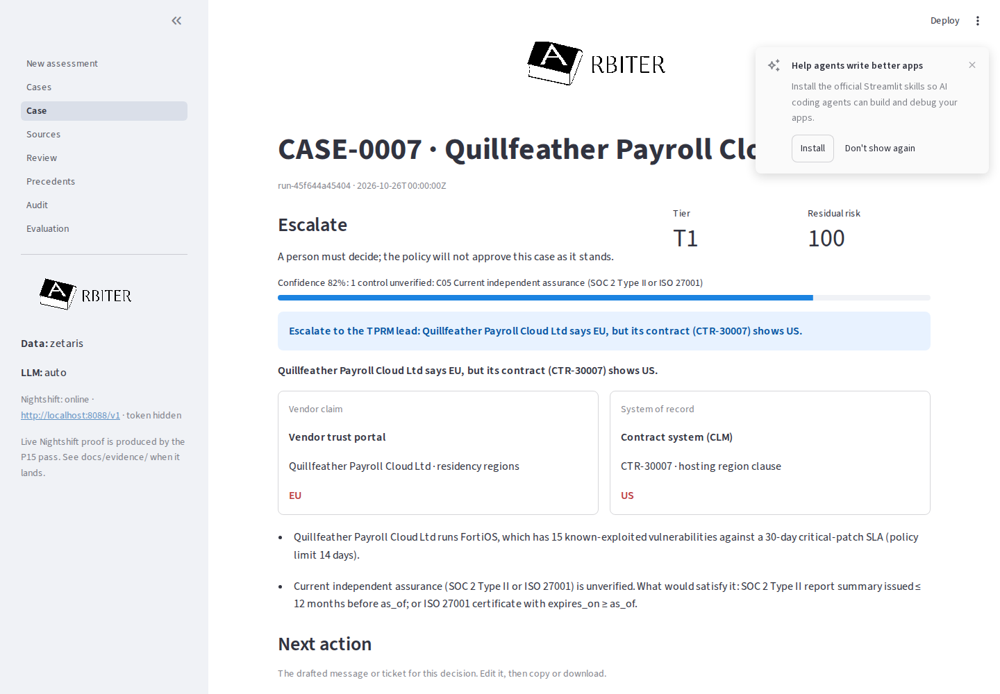
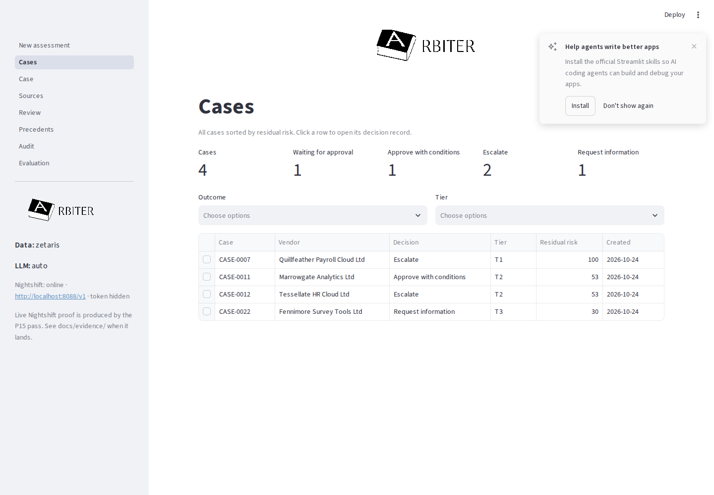
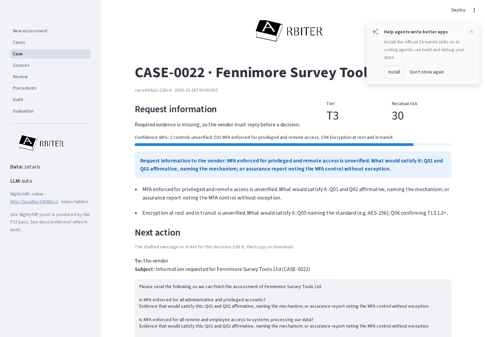
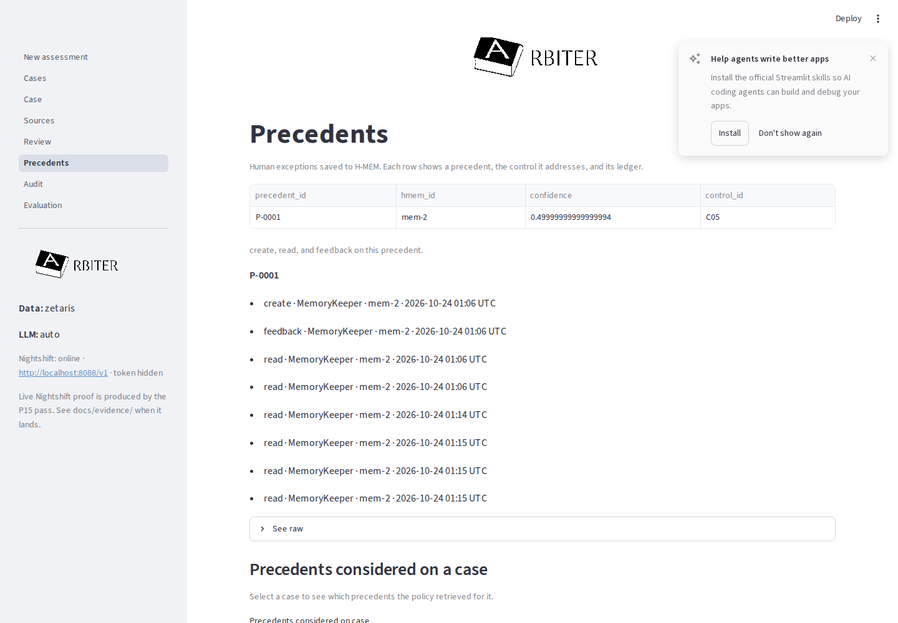
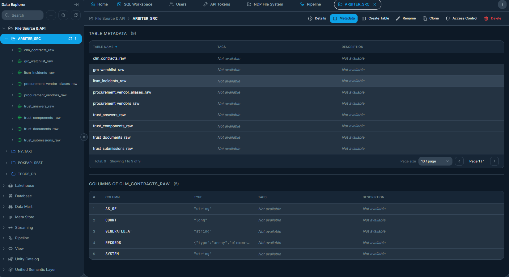
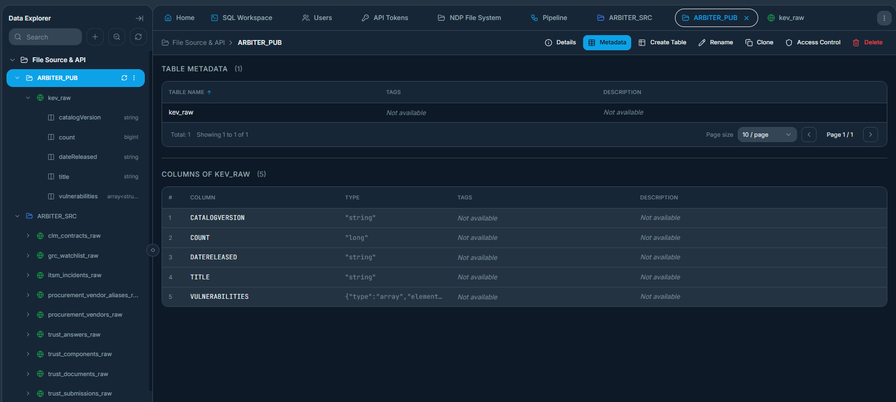
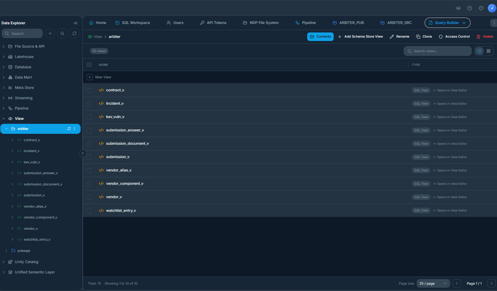

# Arbiter

[](https://github.com/awkwardapples/Arbiter/actions/workflows/ci.yml)


<p align="center">
  
</p>

Auditable reasoning for third-party vendor onboarding: agents gather cited evidence, a versioned policy decides, and the next action is a signed contract.

**Demo video:** the link is added here and in `metadata.json` when the video is uploaded (`docs/SUBMISSION.md`). **Track:** Reasoning Architecture.

## Quick start

Sample mode needs no credentials. It runs the same agents and policy on a DuckDB mirror of the Zetaris model, with the deterministic model fallback:

```bash
docker build -t arbiter .
docker run --rm -p 8000:8000 -e SAMPLE_MODE=true arbiter
curl -s -X POST localhost:8000/run -H "Content-Type: application/json" -d @input_examples/example_2.json
```

Example 2 is Quillfeather Payroll Cloud Ltd. It comes back `ESCALATE`: the vendor says EU-only hosting, its contract says US, and its FortiOS version is on CISA's known-exploited list.

## Why it matters

A third-party risk (TPRM) analyst at a 500–5,000-person company decides whether a new SaaS vendor may touch customer data, and a TPRM lead signs off the exceptions. The evidence sits in five systems and a questionnaire, and the queue does not wait.

- Third parties are involved in 48% of breaches ([Verizon 2026 DBIR](https://www.verizon.com/business/resources/Te26/reports/2026-dbir-data-breach-investigations-report.pdf)).
- Organisations average 2,643 third parties but assess only 36% of them, and 40% have an assessment backlog ([ProcessUnity / Ponemon-Sullivan 2026, n = 1,465](https://ponemonsullivanreport.com/2026/03/state-of-third-party-risk-assessments/)).
- Companies spend 37.4 hours a week assessing vendors ([Whistic 2025 TPRM Impact Report, n = 525](https://www.whistic.com/resources/blog/2025-impact-report-takeaways)).

Arbiter turns one onboarding into a cited, replayable decision with the follow-up already drafted, so the analyst reviews exceptions instead of assembling evidence. The full case, with a before/after table and a labelled capacity estimate, is [docs/IMPACT.md](docs/IMPACT.md).

## Track 3 mapping

| Track word | Arbiter |
|---|---|
| Data | Zetaris USL `vendor_risk`: five enterprise systems plus CISA KEV, one SQL access point (`zetaris/sql/03_usl.sql`) |
| Knowledge | Versioned policy-as-code (`policy/arbiter_policy.v1.yaml`, engine `app/policy/engine.py`) |
| Memory | Meterless H-MEM governed precedents and trust ledger (`app/memory/`) |
| Reasoning | Planner, Evidence, Evaluator and Challenger tool loop on Nemotron via Meterless Nightshift (`app/orchestrator.py`) |
| Reliable | The policy decides, not a model; live evaluation; every decision replays from the audit chain (`app/audit/replay.py`) |
| Decisions | Five outcomes (`APPROVE`, `APPROVE_WITH_CONDITIONS`, `REQUEST_INFO`, `ESCALATE`, `DECLINE`) with a plain-English brief |
| Actions | Drafted next action under an HMAC-signed execution contract with required approvals (`app/actions/`) |

## See it work

Live example 1, `run-83de5da137c0` (Pellucid Forms Ltd), ran on 24 October 2026 against the Zetaris USL and Meterless Nightshift. Outcome `APPROVE`, matching its label, in 159 s; brief: "Approve: Pellucid Forms Ltd meets the checks this assessment could verify." (`output_examples/example_1_output.json`, trace `logs/examples/live/trace-run-83de5da137c0.jsonl`).

Twelve registry queries went through Zetaris, each with a request id:

```jsonl
{"timestamp":"2026-10-24T04:41:21.164571Z","run_id":"run-83de5da137c0","trace_id":"run-83de5da137c0","span_id":"9ff44f96653943a7","parent_span_id":null,"agent_name":"data","action":"query_zetaris","input_summary":"query_id=Q_VENDOR_PROFILE","output_summary":"rows=1 zetaris_request_id=55bf9cc1-e25e-4a48-9b41-f2bda35d935d","target_agent":null,"confidence":null,"retry_count":0,"status":"success","provider":null,"route":null,"model":null,"latency_ms":1024,"tokens_in":null,"tokens_out":null,"purpose":null,"provider_meta":null,"source_system":null,"query_id":"Q_VENDOR_PROFILE","rows":1,"backend":"zetaris","loop":null,"iteration":null,"mode":{"data":"zetaris","llm":"meterless"}}
```

Five agent steps ran on Nemotron through Nightshift, each with a receipt. The Planner's first plan:

```jsonl
{"timestamp":"2026-10-24T04:41:35.414838Z","run_id":"run-83de5da137c0","trace_id":"run-83de5da137c0","span_id":"b644cd34198c4a27","parent_span_id":null,"agent_name":"PlannerAgent","action":"model_call","input_summary":"purpose=plan route=deep response=json attempt=1 prompt_chars=4985","output_summary":"json valid (PlanOut)","target_agent":null,"confidence":null,"retry_count":0,"status":"success","provider":"meterless","route":"deep","model":"nvidia/nemotron-3.5-super-vl-120b-a12b","latency_ms":14180,"tokens_in":3368,"tokens_out":3148,"purpose":"plan","provider_meta":{"requested_model":"meterless/deep","response_id":"chatcmpl-02a396e9-0707-4dab-bfd1-542a5ae7ff5a","schema":"meterless.compute_receipt.v1","receipt_id":"rcpt_req_ltd0d684","decision_id":"req_ltd0d684","provider_model":"meterless/auto","routed_model":"nvidia/nemotron-3.5-super-vl-120b-a12b","mode":"auto","requires_review":"False","winning_route.provider":"nvidia","winning_route.label":"Nemotron 3.5 Super VL 120B A12B","winning_route.kind":"cloud","winning_route.tier":"C","winning_route.model":"nvidia/nemotron-3.5-super-vl-120b-a12b","app_policy.app":"arbiter","app_policy.has_rule":"True","app_policy.bound_mode":"auto","app_policy.requested_mode":"deep","app_policy.routed_mode":"auto","app_policy.mode_coerced":"True","app_policy.privacy":"cloud-ok","cost.actual_usd":"0","cost.naive_usd":"0","cost.race_overhead_usd":"0","cost.verifier_usd":"0","cost.baseline.model":"nvidia/nemotron-3.5-super-vl-120b-a12b","cost.baseline.label":"Nemotron 3.5 Super VL 120B A12B","cost.baseline.source":"mode-default-frontier","savings.amount":"0","savings.currency":"USD","savings.vs":"Nemotron 3.5 Super VL 120B A12B","savings.baseline_source":"mode-default-frontier","no_think":"true"},"source_system":null,"query_id":null,"rows":null,"backend":null,"loop":null,"iteration":null,"mode":{"data":"zetaris","llm":"meterless"}}
```

The Evaluator then sent the Planner back for missing incident and contract evidence:

```jsonl
{"timestamp":"2026-10-24T04:42:44.302557Z","run_id":"run-83de5da137c0","trace_id":"run-83de5da137c0","span_id":"070a17b8d08d4146","parent_span_id":null,"agent_name":"EvaluatorAgent","action":"evaluate","input_summary":"claims=16 queries=8","output_summary":"gaps: C06→Q_VENDOR_INCIDENTS; C09→Q_VENDOR_CONTRACT","target_agent":"PlannerAgent","confidence":null,"retry_count":0,"status":"needs_revision","provider":null,"route":null,"model":null,"latency_ms":null,"tokens_in":null,"tokens_out":null,"purpose":null,"provider_meta":null,"source_system":null,"query_id":null,"rows":null,"backend":null,"loop":null,"iteration":1,"mode":{"data":"zetaris","llm":"meterless"}}
```

The reviewer console (`python run.py ui`; screenshots from `scripts/capture_ui.py`):

| Case: claim versus record | Queue by residual risk |
|---|---|
|  |  |
| **Drafted next action** | **Governed precedents** |
|  |  |

## How it works

An onboarding request goes in, by `vendor_id` or as a free-form questionnaire. The orchestrator (`app/orchestrator.py`) is an explicit state machine: INTAKE → PLAN → GATHER → EVALUATE → DECIDE → MEMORY_CHECK → CHALLENGE → REPORT → CONTRACT → EXECUTE → DONE.

| Name in traces | Kind | Lane | Can | Cannot |
|---|---|---|---|---|
| `PlannerAgent` | LLM + fallback | deep | Choose registry queries from the USL catalogue; revise the plan | Write SQL, or skip a required control |
| `EvidenceAgent` | Tools + LLM + fallback | fast | Run registry queries, run ScoutGuard, extract claims with verbatim quotes | Mark a claim verified |
| `EvaluatorAgent` | Code + LLM critic | fast | Ground quotes, cross-check claims against systems of record, send the plan back | Decide an outcome |
| `PolicyEngine` | Code | – | Tier the vendor; produce the outcome and what evidence would change it | Call a model |
| `MemoryKeeper` | Meterless H-MEM | – | Retrieve lead-approved precedents; record feedback | Change the policy |
| `ChallengerAgent` | LLM + deterministic triggers | deep | Attack the candidate decision; request one re-plan; escalate | Approve or upgrade an outcome |
| `ReporterAgent` | Template + optional LLM rewrite + validator | deep | Write the cited brief and draft the next action | Cite anything outside the decision record |
| `ScoutGuard` | Meterless Scout subset | – | Block, warn or pass untrusted vendor text; redact PII | Decide |
| `ActionExecutor` | Scout execution contracts | – | Issue and verify signed contracts; run the outbox once approvals exist | Act without a valid contract |

- **Loops.** Evaluator → Planner at most twice; Challenger → Planner at most once. The Challenger can escalate but never approve.
- **Policy.** Only `app/policy/engine.py` maps facts to an outcome. A model's worse extraction can lower an outcome (more evidence missing), never raise it.
- **Memory.** A precedent changes a later case only through an exception the policy allows, and only when a `tprm_lead` approved it.
- **Guard.** Vendor answers and documents pass `app/guard/scout_guard.py` before any model sees them; blocked content escalates.
- **Contracts.** No side effect without a valid, unexpired, HMAC-signed `ExecutionContract` (`app/actions/contracts.py`).
- **Bounded.** Timeouts on every call (Zetaris 30 s, Nightshift 180 s); a 600 s run budget, after which the case escalates safely. Every model step has a deterministic fallback, labelled `fallback` in the trace.

Details: [docs/ARCHITECTURE.md](docs/ARCHITECTURE.md).

## Zetaris USL

Five synthetic enterprise systems (procurement, CLM, ITSM, GRC watchlist, vendor trust portal) are served by `sources/` and onboarded into Zetaris as Lightning REST tables, alongside the CISA KEV catalogue (`zetaris/sql/01_sources.sql`, `zetaris/sql/02_kev.sql`). SchemaStore views clean them, and `zetaris/sql/03_usl.sql` compiles and activates one Unified Semantic Layer, `vendor_risk`: 10 tables with business descriptions and keys.

- **One access path.** Every agent query is a registry id (`app/data/queries.yaml`) resolved against the USL. `Q_VENDOR_360` is the USL merge of vendor, contract, submission, components and KEV.
- **Agents read the model.** The Planner gets a 304-token catalogue of the USL (tables, keys, descriptions) instead of raw schemas.
- **Data quality in the layer.** Zetaris DQ rules (`zetaris/dq_rules.yaml`) flag contract `CTR-30028` as a DPA marked signed without a date. The policy then treats that control as unknown.
- **Verified.** The parity run (`docs/passes/P1-B_parity.json`) is `query_layer: usl`, `all_green: true`: 416/416 registry comparisons against the mirror, DQ keys matching, 32/32 KEV checks.

| Lightning REST tables | KEV REST table | SchemaStore views |
|---|---|---|
|  |  |  |

The full build, bisect and reflection are in [docs/ZETARIS_USL.md](docs/ZETARIS_USL.md).

## Nemotron and Nightshift

Every model call goes through one seam, `app/llm/generator.py`, to Meterless Nightshift (`app/llm/providers/meterless.py`). Arbiter requests a lane, `meterless/fast` or `meterless/deep`; Nightshift chooses the Nemotron model and returns a compute receipt, which the trace keeps. `python run.py llm proof` wrote `docs/evidence/nightshift_proof.json`:

| Lane | Arbiter sent | Routed mode | Model served | Receipt |
|---|---|---|---|---|
| fast | `meterless/fast` | `auto` (coerced) | `nvidia/nemotron-3.5-lightning-30b-a3b` | `rcpt_req_924f14pn` |
| deep | `meterless/deep` | `auto` (coerced) | `nvidia/nemotron-3.5-super-vl-120b-a12b` | `rcpt_req_p412l7ql` |

Which agent steps run on which lane: planning and challenge request the deep lane; claim extraction and critique request the fast lane. In live example 1 all five successful calls were served by Nemotron 3.5 Super VL. The brief came from the deterministic template (`generator=template:v1`), so every sentence in it is checkable.

**Deviation, stated plainly.** The deep lane runs `nvidia/nemotron-3.5-super-vl-120b-a12b`. It was designed for `nvidia/nemotron-3-super-120b-a12b`, which returns 404 on this NVIDIA account (not entitled). Separately, a Nightshift Default app rule coerces both lanes to `auto`, which picks the model per request, so lane separation is not guaranteed: most live calls on both lanes landed on Super VL, and large deep-lane prompts sometimes landed on Lightning and returned HTTP 502. Meterless has acknowledged the routing bug, with a fix targeted for its Sunday release. Every receipt records the coercion (`app_policy.mode_coerced: True`). Operator observations and the vendor acknowledgement: `docs/evidence/nightshift_deviations.md`.

## Evaluation

**Live evaluation: 5/5 on the first 5 test cases, with 5 of 25 model calls falling back to deterministic. The baseline could not be measured — all 9 baseline calls returned 502 from Nightshift's forced auto mode. Arbiter offline remains 16/16 on the full test split.**

- Live Arbiter: 0 unsafe approvals; 4/4 consistency repeats identical; the one residency contradiction in the subset (VND-0007) found; p50 141.8 s per case.
- The baseline is one Nemotron prompt with the policy and all the evidence. Its 0/5 measures Nightshift routing, not single-model quality, so it is **not** reported as an Arbiter win.
- n is small: five live cases give a Wilson 95% interval of 0.57–1.00 on accuracy.

The block below is the rendered `eval/results_live/20261024T045916036274Z/summary.json`; `tests/unit/docs/test_claims.py` checks that it matches the latest live summary. `python run.py eval --live --publish` regenerates `docs/EVALUATION.md`, not this README block. Method, labels and discussion: [docs/EVALUATION.md](docs/EVALUATION.md).

<!-- EVAL:START -->
# Evaluation

Synthetic data. Small n. Intervals are Wilson 95% where a rate has a denominator.
Only the tier gates are calibrated. Weights stay at their a-priori values.

- mode: live (zetaris / meterless)
- provider: meterless
- model ids (from traces): nvidia/nemotron-3.5-super-vl-120b-a12b, nvidia/nemotron-3.5-lightning-30b-a3b
- splits: test
- n: 20
- git sha: 4b4680b0586ae50003f87bab2337931aa6f6c37b
- generated: 2026-10-24T05:35:05Z

| System | Accuracy | Unsafe approvals | Invalid | Abstention |
|---|---:|---:|---:|---:|
| arbiter | 1.000 (5/5) | 0/5 | — | 0.200 (1/5) |
| arbiter_offline | 1.000 (16/16) | 0/16 | — | 0.375 (6/16) |
| baseline | 0.000 (0/5) | 0/5 | 1.000 (5/5) | 0.000 (0/5) |

Reduced n: n=5 for the live systems, n=16 for the offline system; the live subset is the first 5 test cases by case_id.

| System | Mode | n | Contradiction recall | Failing-control recall | p50 ms | p95 ms | Model calls/case | Model-call fallback |
|---|---|---:|---:|---:|---:|---:|---:|---:|
| arbiter | zetaris / meterless | 5 | 1.000 (1/1) | 1.000 (2/2) | 141817 | 233333 | 5.0 | 0.200 (5/25) |
| arbiter_offline | duckdb / offline | 16 | 1.000 (2/2) | 1.000 (6/6) | 436 | 611 | 0.0 | — |
| baseline | zetaris / meterless | 5 | 0.000 (0/1) | 0.000 (0/2) | 58800 | 80770 | 1.0 | 1.000 (5/5) |

- deep lane routed to: nvidia/nemotron-3.5-super-vl-120b-a12b, nvidia/nemotron-3.5-lightning-30b-a3b (from trace receipts)
- fast lane routed to: nvidia/nemotron-3.5-super-vl-120b-a12b (from trace receipts)
<!-- EVAL:END -->

## Setup and usage

### Sample mode (no credentials)

```bash
docker build -t arbiter .
docker run --rm -p 8000:8000 -e SAMPLE_MODE=true arbiter
curl -s localhost:8000/health
```

Or natively, with Python 3.12:

```bash
python -m venv .venv
python scripts/tasks.py setup
SAMPLE_MODE=true LLM_PROVIDER=offline python run.py serve
```

`SAMPLE_MODE=true` runs the same agents, registry query ids and policy against a DuckDB mirror of the Zetaris tables. With `LLM_PROVIDER=offline`, or when Nightshift is unreachable under `LLM_PROVIDER=auto`, model steps use the deterministic fallback and the trace says `provider: offline`. The fallback is real logic, not a stored answer.

### Live mode

Live mode needs Zetaris and Meterless Nightshift. Nightshift listens on the host loopback, so the API runs natively. Copy `.env.example` to `.env` and fill in the keys locally; never commit `.env`.

```bash
python run.py zetaris onboard --dry-run
python run.py preflight
python run.py llm proof
python run.py serve
```

`python run.py preflight` prints provider and data status without secrets. Set `METERLESS_NO_THINK=1` to prepend the `/no_think` system message Meterless suggested for Nemotron reasoning models (`docs/evidence/nightshift_deviations.md`).

### Commands

```bash
python run.py assess --input input_examples/example_1.json
python run.py examples
python run.py replay CASE-0003
python run.py ui
python run.py audit-verify
python run.py llm status
python run.py eval --split test --systems arbiter_offline
python scripts/tasks.py verify
```

`POST /run` takes exactly one of `vendor_id` or `submission`, so a judge can post their own vendor:

```bash
curl -s -X POST localhost:8000/run -H "Content-Type: application/json" -d '{"submission":{"legal_name":"Example Payroll Ltd","category":"software","requested_service":"payroll processing","criticality":"low","annual_spend_gbp":1000,"data_categories":["internal"],"processing_countries":["UK"],"answers":[{"question_id":"Q01","question":"Is MFA enforced?","answer_text":"Yes."}]}}'
```

Human review and approvals:

- `POST /cases/{case_id}/review` with `reviewer`, `role`, `decision` and a `rationale` of at least 30 characters (`?dry_run=true` checks precedent eligibility without writing).
- `POST /contracts/{contract_id}/approve` with `by`, `role`, `decision` (`approve` or `reject`) and a `rationale`.
- `GET /cases` returns the queue; `POST /cases/{case_id}/replay` replays a stored decision.

Roles in the shipped policy are `tprm_analyst` and `tprm_lead`. Declines and precedent exceptions require the lead.

### Failure handling

| Failure | What the code does | Trace status |
|---|---|---|
| Zetaris timeout or upstream error | Up to three attempts (1 s, then 3 s), then the DuckDB mirror answers that query | `retrying`, then `fallback` |
| Zetaris 401 or 403 | No retry; DuckDB for the rest of the run | `fallback` |
| Nightshift unreachable | Resolution tries NVIDIA direct, then the offline generator | `fallback` |
| Nightshift HTTP 502 on a call | That step uses its deterministic fallback | `fallback` |
| Model returns invalid JSON | One repair call, then the deterministic fallback | `retrying`, then `fallback` |
| Quote not in the source | The claim is ungrounded; the Evaluator sends the plan back if a required control is affected | `needs_revision` |
| Injection detected | ScoutGuard blocks the segment and the decision escalates | `blocked`, then `escalated` |
| Budget exceeded or unhandled error | Safe escalation with the template report | `error`, then `escalated` |

## Sponsor technology

- **Zetaris:** the USL `vendor_risk`, Lightning REST tables, SchemaStore views, DQ rules and the federated KEV join; every live query carries a request id.
- **Meterless:** Nightshift runs every model call with a receipt; H-MEM holds governed precedents (13 upstream conformance vectors); the Scout subset guards untrusted text and signs every action.
- **NVIDIA:** Nemotron 3.5 Super VL and Nemotron 3.5 Lightning, served through Nightshift, do the planning, extraction, critique and challenge.
- **Cursor:** project rules, Plan Mode per pass, tests-first, a stop-hook verify loop and parallel worktrees.

Every claim, with its file and a verbatim trace line: [docs/SPONSORS.md](docs/SPONSORS.md).

## AI and model usage

**At runtime**, the only models that ran are NVIDIA Nemotron 3.5 Super VL (`nvidia/nemotron-3.5-super-vl-120b-a12b`) and Nemotron 3.5 Lightning (`nvidia/nemotron-3.5-lightning-30b-a3b`), through Meterless Nightshift; the trace receipts show which served each call. Models plan, extract, critique and challenge. They never decide the outcome.

**To build it**, application code for passes P0 to P14-A was written by Cursor agents (Composer, Grok 4.7 and Claude Opus as the agent model). P14-B, P15 and P17 were done in Claude Code (Claude Sonnet 5.5 and Claude Opus 5.5). The per-pass record is the table in [docs/CURSOR_USAGE.md](docs/CURSOR_USAGE.md), compiled from `docs/cursor-usage/`. The architecture specs (Release 1 and 2), the independent reviews and the small Release 2 tooling patch (lane ids, markers, opt-in Docker test) were drafted by Claude (Anthropic) outside the repo and applied and committed through Cursor. I reviewed every change.

There is no agent framework; coordination is the state machine in `app/orchestrator.py`.

## Data and licensing

All enterprise records under `data/sample/` are synthetic, generated in the build window by a seeded generator:

```bash
python run.py generate-data --seed 2026 --as-of 2026-10-26
```

The KEV data is a filtered snapshot of the CISA Known Exploited Vulnerabilities catalogue (CC0 1.0), attributed in `data/kev/SOURCE.md`. Zetaris federates the same 84-row snapshot. A refresh that hits the network:

```bash
python run.py generate-data --refresh-kev --seed 2026 --as-of 2026-10-26
```

Arbiter itself is MIT-licensed.

## Third-party code and licences

Runtime libraries, pinned in `requirements.txt`: FastAPI, pydantic, DuckDB, Streamlit, httpx, tenacity and PyYAML.

Meterless H-MEM conformance vectors and Scout adversarial eval cases are Apache-2.0, ported and copied with notices in `vendor/meterless/NOTICE.md` and `vendor/meterless/NOTICE-scout.md`; the licence text is `vendor/meterless/LICENSE`. CISA KEV is CC0 1.0.

## Limitations

- The enterprise systems are simulated and the company data is synthetic. KEV is the public catalogue, as a committed snapshot.
- The live evaluation covers five cases; the offline one covers 16. These numbers show the live path works end to end, not a precision estimate.
- The single-model baseline is unmeasured live (every call returned 502). Live Arbiter took a median of 141.8 s per case, almost all of it model calls.
- Nightshift lane routing is coerced to `auto` until the vendor fix ships, so the lane-to-model mapping is not guaranteed (see above).
- Only one of the six input examples has a successful live run committed. Example 3's two live attempts failed on their first call and are kept in `logs/examples/live_failed/`.
- No OCR of real PDFs, no SSO or RBAC beyond the policy's role strings, and the outbox writes local files rather than sending email or opening real tickets.
- One decision type (SaaS onboarding that may process personal data) and twelve controls.

## Responsible AI

A human reviews exceptions and declines: the policy requires `tprm_lead` for a decline and for a precedent exception. Models never decide outcomes, and the Challenger can only escalate or ask for more evidence. ScoutGuard treats vendor text as data and redacts PII before any model sees it. Nothing external is sent on its own: the executor writes the outbox only after a valid, unexpired, signed contract whose approvals are present. Every decision replays from the hash-chained audit log.

## Pre-existing components

Declared in [docs/PRIOR_WORK.md](docs/PRIOR_WORK.md):

1. Design documentation (`docs/spec/`, `AGENTS.md`, `.cursor/` rules, commands and hook scripts), written 20–21 Oct 2026 before the build window and committed after it opened. It contains no application code.
2. The problem framing and pitch narrative from an earlier prototype, Vendor-Risk-Assessment-Agent (React/Node). No code from it is used.
3. Market-research slide material (problem, users, competitors), refreshed for the deck.
4. Third-party material under its own licence: Meterless H-MEM vectors and Scout eval cases (Apache-2.0), and CISA KEV (CC0 1.0).

## Repository map

| Path | What it is |
|---|---|
| `app/` | API, orchestrator, agents, policy engine, data clients, guard, memory, actions, audit |
| `policy/` | Versioned policy YAML and calibration |
| `zetaris/` | Onboarding SQL, USL build, DQ rules, parity |
| `sources/` | Enterprise-systems simulator that Zetaris federates |
| `data/` | Synthetic sample data, KEV snapshot, generator, eval labels |
| `eval/` | Harness, baseline, offline results and `eval/results_live/` |
| `ui/` | Streamlit reviewer console |
| `input_examples/`, `output_examples/` | Six inputs; live output for example 1 and the sample-mode set in `output_examples/sample_mode/` |
| `logs/examples/` | Traces: `live/`, `session/` (memory), `sample_mode/`, `live_failed/` |
| `docs/` | Architecture, impact, sponsors, evaluation, USL, evidence, demo script, slides, submission |
| `vendor/meterless/` | Third-party vectors and notices |
