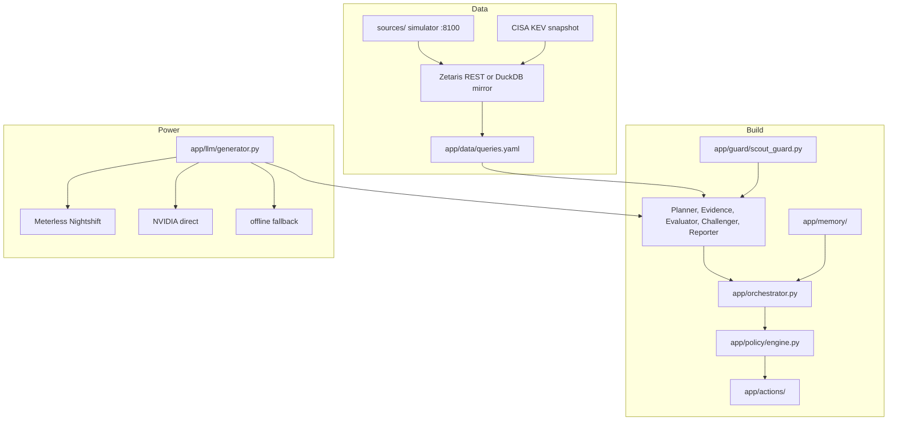
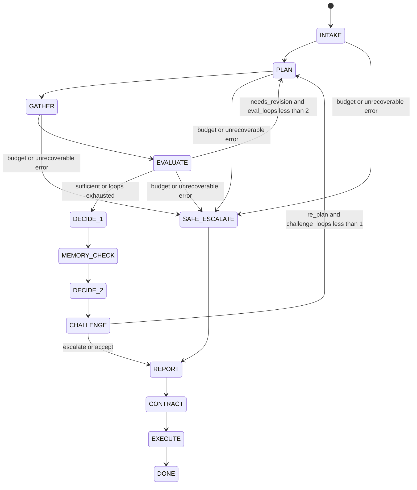
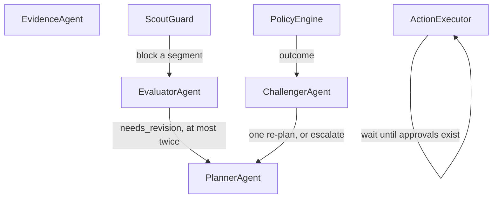
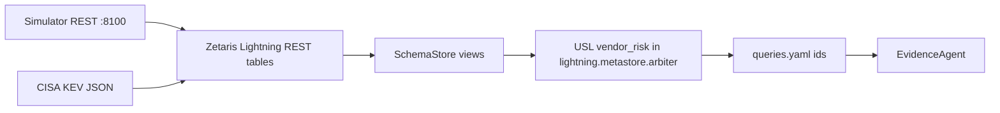
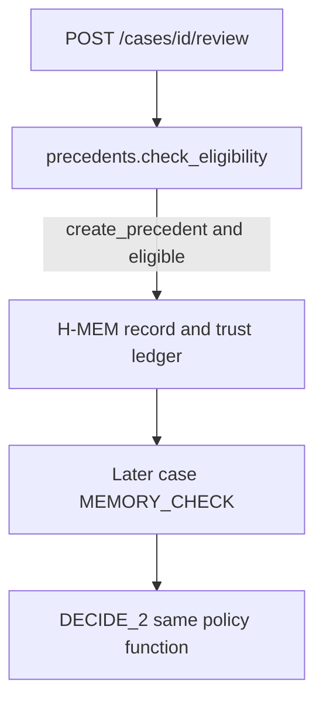
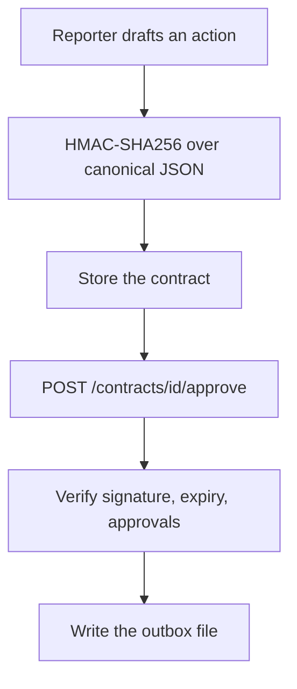

# Architecture

Arbiter is a state machine. Models plan, extract, criticise, and write. `app/policy/engine.py` is the only place an outcome is chosen.

## Layers

Sample mode (`SAMPLE_MODE=true`) swaps the Zetaris client for the DuckDB mirror. Query ids and columns stay the same. See `app/data/factory.py`.

## State machine

Loops are the two edges back to `PLAN`. The Evaluator may take that edge at most twice. The Challenger may take it once.

`DECIDE_2` is the same policy function as `DECIDE_1`, with precedent candidates added. An escalate from the Challenger sets the outcome to the worse of the policy outcome and `ESCALATE`, so a `DECLINE` stays a `DECLINE`. The run budget is 600 seconds.

## Agent authority

Who is allowed to stop a line of work, or to make the Planner run again:

The Planner cannot write SQL. The Evidence agent cannot mark a claim verified. The Challenger cannot approve. The policy engine does not call a model. The table in the README is the same contract.

## Data path

Registry queries are the only data path agents use. There is no connector inside an agent.

`Q_COMPONENT_KEV` joins declared components to the KEV table. In sample mode the backend field on that event is `duckdb`. The SQL for the live model is `zetaris/sql/03_usl.sql`. Data-quality rules live in `zetaris/dq_rules.yaml` and surface as `Q_DQ_INVALID`.

## Model lanes

Agents ask `app/llm/generator.py` for a route, not a model. Planner, Challenger and Reporter use `deep`; Evidence and the Evaluator critic use `fast`. The Meterless provider sends `meterless/deep` or `meterless/fast`, and Nightshift chooses the Nemotron model and returns a receipt that the trace keeps in `provider_meta`.

In the committed live evidence the models served were `nvidia/nemotron-3.5-super-vl-120b-a12b` and `nvidia/nemotron-3.5-lightning-30b-a3b` (`docs/evidence/nightshift_proof.json`). A Nightshift app rule currently coerces both lanes to `auto`, so the lane does not fix the model; see `docs/evidence/nightshift_deviations.md`. If Nightshift is unreachable, resolution tries NVIDIA direct (`app/llm/providers/nvidia.py`) and then the offline generator.

## Memory governance

Examples in this repo are generated with `ARBITER_MEMORY=off`, so a sample trace shows `precedents=0`. The path is still the one below. A precedent changes a later outcome only through the policy's precedent-exception clause, and only after the required human role approves.

Retrieval does not decide. Feedback (`helpful` or `wrong`) is written back to the ledger. The conformance vectors for the port are `tests/conformance/test_hmem_conformance.py`.

## Contract signing and verification

The signature covers the contract without the signature field (`app/actions/contracts.py`). A child contract is issued when an approval is added. The executor refuses a missing, expired, or under-approved contract. Replay (`app/audit/replay.py`) runs the policy again and checks the policy hash, the record hash, and the contract signatures.
