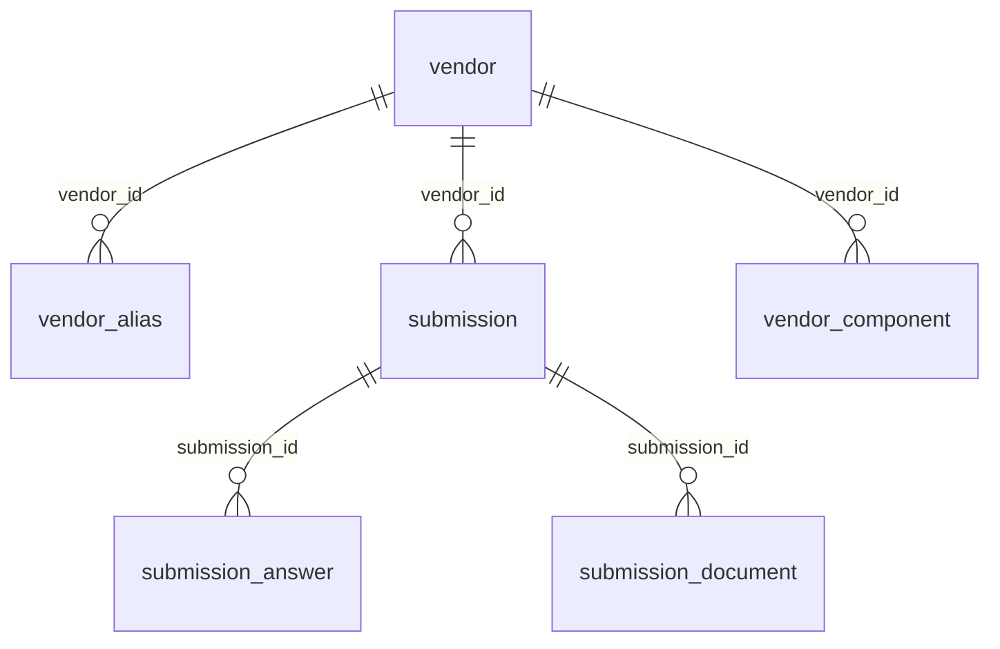

# Zetaris USL `vendor_risk`

Measured on 23 Oct 2026 against the local Zetaris SQL editor on port 8888. The process that ran parity set `ZETARIS_QUERY_LAYER=usl`. The settings loaded for the earlier read-only check reported `views`. `.env` was not opened.

## 1. Sources

Six systems. Enterprise rows are synthetic. CISA KEV is public CC0.

| System | What it holds | Key | How a vendor is named | Why it matters |
|---|---|---|---|---|
| Procurement | Onboarding request, tier inputs, spend | `vendor_id` (`VND-…`) | `clm_supplier_ref` (`SUP-…`) | The master row a decision is about |
| Procurement aliases | Other names for the same vendor | `alias_id` | `vendor_id`, `alias_lower` | Matches incidents and the watchlist |
| CLM | DPA, hosting region, breach notice, renewal | `contract_id` | `supplier_ref` | Contract controls |
| ITSM | Incidents | `incident_number` | `vendor_name_raw` (free text) | Operational history |
| GRC watchlist | Sanctions and restricted-party names | `entry_id` | `entity_name` | Screening |
| Trust portal | Submission, answers, documents, declared components | `submission_id` and child keys | `vendor_id` | Assurance and the software inventory |
| CISA KEV | Known exploited vulnerabilities | `cve_id` | `vendor_project` and `product` | Whether a declared component is on the catalogue |

## 2. Onboard

P1-B had already created `ARBITER_SRC`, `ARBITER_PUB`, and the `arbiter` SchemaStore container. Those creates were skipped. `SHOW LIGHTNING TABLES ARBITER_PUB` returned one REST table:

`kev_raw` endpoint `https://raw.githubusercontent.com/awkwardapples/Arbiter/main/data/kev/kev_snapshot.json`, id 1084.

`SELECT COUNT(*) AS c FROM arbiter.kev_vuln_v` returned 84.

The reload statement, with `{KEV_URL}` filled from settings, was:

```sql
CREATE LIGHTNING REST TABLE kev_raw FROM ARBITER_PUB REQUEST(
    endpoint "https://raw.githubusercontent.com/cisagov/kev-data/develop/known_exploited_vulnerabilities.json",
    method "get",
    response_type "json",
    http_encoding "URLENCODED"
) HEADER () BODY ()
```

HTTP 400: `A table named "kev_raw" already exists in database "ARBITER_PUB".`

Zetaris can reach `www.cisa.gov`. This session statement returned HTTP 200 in 712 ms, and `SELECT * FROM session.kev_cisa_probe` returned one row: `catalogVersion` `2026.10.21`, `count` `1754`, `dateReleased` `2026-10-21T14:04:39.8983Z`. The session table was then dropped. The configured `KEV_URL` host is `raw.githubusercontent.com`, not `cisa.gov`. The persistent table was not replaced, so `arbiter.kev_vuln_v` and the activated `kev_vuln` USL table still read the 84-row snapshot.

Enterprise view counts used by parity, all matching the sample files: vendor 32, alias 64, contract 32, incident 2, watchlist 2, submission 32, answers 504, documents 9, components 2.

## 3. USL build

`SHOW NAMESPACES OR TABLES IN lightning.metastore.arbiter` was empty, so `COMPILE USL IF NOT EXISTS vendor_risk DEPLOY` kept `IF NOT EXISTS`. HTTP 200, `timeUsed` 645. The returned model is `vendor_risk` under `["metastore","arbiter"]` with the ten tables below.

`SHOW TABLES IN lightning.metastore.arbiter.vendor_risk` then returned `total` 10, each `catalog_type` `Unified Semantic Layer`.

There is no USL table named `vendor_360`. That name is the registry query `Q_VENDOR_360`.

### Bisect

`COMPILE USL` without `DEPLOY` stores nothing. These probes used the name `usl_probe` except the last row.

| Probe | HTTP | Result |
|---|---|---|
| 10-table DDL with a column named `text` | 400 | `Invalid DDL statement. Please provide a valid CREATE TABLE statement using Spark SQL or ANSI SQL syntax.` |
| `vendor`, varchar only | 200 | Model JSON returned |
| `int`, then `decimal(14,2)`, then `date`, then `boolean` | 200 | Each type accepted |
| Second table with `FOREIGN KEY REFERENCES` | 200 | FK recorded |
| Column name `text` alone | 400 | Same invalid-DDL message |
| Names `status`, `version`, `category` alone | 200 | Accepted |
| 10-table DDL with `doc_text` instead of `text` | 200 | Model `vendor_risk`, 10 tables |

The fix is only in the USL. `submission_document.doc_text` is `text AS doc_text` in `ACTIVATE`. `Q_SUBMISSION_DOCUMENTS` has `sql_usl` that selects `doc_text AS text`. DuckDB and `arbiter.submission_document_v` still use `text`.

### Descriptions and keys

Eleven `UPDATE USL … SET DESCRIPTION` statements each returned HTTP 200 `updated=true`.

Declared foreign keys, from the compile JSON:



`contract` joins procurement on `clm_supplier_ref = supplier_ref`. That match is not a declared foreign key. `kev_vuln` has no foreign key; `Q_VENDOR_360` matches it in the query.

### Data-quality rules

Five `REGISTER DQ` statements returned HTTP 200. Each body is the model JSON with that rule added under `dqAnnotations`. No rule names `doc_text` or `text`.

`dq_vendor_spend` has no `RUN DQ` line of its own. `RUN DQ` is one statement per table, and `contract` carries two rules, so the file has five `REGISTER` lines and four `RUN` lines. The vendor run includes `dq_vendor_spend`.

| Statement | HTTP | Result |
|---|---|---|
| `RUN DQ TABLE …contract` | 200 | `dq_contract_dpa_date` 32 total, 31 valid, 1 invalid. `dq_contract_breach_hours` 32/32/0. `contract_id` primary key 32/32/0. `timeUsed` 9955 |
| `RUN DQ TABLE …submission_document` | 200 | `dq_document_dates` 9/9/0. `doc_id` primary key 9/9/0. `submission_id` foreign key 9/9/0. `timeUsed` 7707 |
| `RUN DQ TABLE …incident` | 200 | `dq_incident_rca` 2/2/0. `incident_number` primary key 2/2/0. `timeUsed` 6239 |
| `RUN DQ TABLE …vendor` | 200 | `dq_vendor_spend` 32/32/0. `vendor_id` primary key 32/32/0. `timeUsed` 3986 |

`SHOW DQ ALL INVALID TABLE lightning.metastore.arbiter.vendor_risk.contract` returned one record, `contract_id` `CTR-30028`.

## 4. Reflection

`wc -l` on 23 Oct 2026:

| Path | Lines | Role |
|---|---|---|
| `app/data/duckdb_backend.py` | 162 | Sample mirror: flatten, alias joins, the same query ids |
| `app/data/dq.py` | 61 | Sample DQ, the same five expressions |
| `app/data/queries.yaml` | 300 | Registry, including `Q_VENDOR_360` |
| `zetaris/sql/03_usl.sql` | 81 | Namespace, compile, descriptions, activate, register, run |
| `zetaris/dq_rules.yaml` | 22 | The five expressions shared by both paths |

The USL does not delete the mirror. Sample mode still runs DuckDB. Live mode with `ZETARIS_QUERY_LAYER=usl` reads the activated model through the same query ids.

`Q_VENDOR_360` is the merge. There is no second Python join beside that SQL. It inner-joins `vendor` to `contract` on `clm_supplier_ref = supplier_ref`, inner-joins `submission` on `vendor_id`, left-joins `vendor_component` on `vendor_id`, and left-joins `kev_vuln` when `lower(vendor_project)` matches and `lower(k.product)` contains `lower(comp.product)`. The component join is a left join because the sample has components for 2 of 32 vendors. An inner join would drop the other 30. Vendor, contract, and submission are inner joins because the sample is one-to-one (32/32/32). A vendor with no contract or no submission would disappear from the 360.

One call for `VND-0001`, same row on both sides (`component_count` 0, `kev_cve_count` 0): DuckDB 37 ms, USL 5220 ms. The USL figure is one HTTP round trip, not a warmed average.

`ZETARIS_QUERY_LAYER=usl .venv/bin/python run.py zetaris parity` printed `all_green=True` after 656 seconds and wrote `docs/passes/P1-B_parity.json`. That file records `query_layer` `usl`, `source_mode` `github_raw`, 9 table counts matching the sample files, 416 registry comparisons all ok (13 query ids × 32 vendors, including `Q_VENDOR_360` at 1 row each), DQ keys matching (`CTR-30028` on contract, empty on the other ruled tables), and 32/32 KEV subset hits. `Q_COMPONENT_KEV` and `Q_KEV_BY_PRODUCTS` stay out of the hash loop. Both sides still read the 84-row snapshot, so those hashes can match. A later live catalogue would not: the feed grows, and a full row hash is the wrong comparison.

Adding a source on the USL path is a REST table, a SchemaStore view, one `CREATE TABLE` inside the compile statement, and one `ACTIVATE`. The registry then points `{T.<table>}` at `lightning.metastore.arbiter.vendor_risk.<table>`. The mirror path adds a sample file, a DuckDB loader, and the same registry placeholder.

## 5. Day to day

The contract rule `dq_contract_dpa_date` is `dpa_signed = false OR dpa_signed_date IS NOT NULL`. Zetaris marked 1 of 32 contracts invalid. The invalid row is `CTR-30028` (`SUP-7028`, status `signed`, `dpa_signed` true, `dpa_signed_date` null), the Kestrel Docs contract. `SHOW DQ ALL INVALID` returns it before a case decision. Evidence turns that key into a flag, and the policy engine, not the model, maps `dpa.signed` to UNKNOWN.

Table descriptions are the sentences stored by the eleven `UPDATE` statements. They are the business definition of each table for a reviewer and for the Planner catalogue.

## 6. Why it matters to agents

`compact_catalogue()` is 1219 characters, 304 tokens (`len//4`): one line per table, primary key, each foreign key as `fk→table.column`, and the description. A names-only column list of the same model is 1103 characters, 275 tokens. The catalogue is longer than the bare names because it carries the descriptions and the keys. The keys are what tell a planner that `vendor_alias.vendor_id` corroborates procurement, and that submission children hang off `submission_id`.

DQ failures are rows with keys, not a silent filter. The one invalid contract is `CTR-30028`.

## 7. Limits

- Enterprise rows are synthetic. KEV is the public catalogue, currently the 84-row snapshot inside `kev_raw`.
- Zetaris reached `www.cisa.gov` and returned catalogue count 1754. Replacing `kev_raw` failed because the table already exists. The view and the USL table were not re-activated onto the live feed. Dropping `kev_raw` is a separate go. The README fallback remains the snapshot.
- This parity run set `ZETARIS_QUERY_LAYER=usl` on the process. A later process that still has `views` in its environment reads `arbiter.*_v`.
- `data/usl/vendor_risk.model.json` is still the `COMPILE` payload from before descriptions were stored. `load_model()` fills empty descriptions from `03_usl.sql`. A `LOAD USL` export has not replaced the file.
- The three screenshots under `docs/img/` were not captured in this run.
- `Q_VENDOR_360` is not in the deterministic screen set. A caller has to select that query id.
